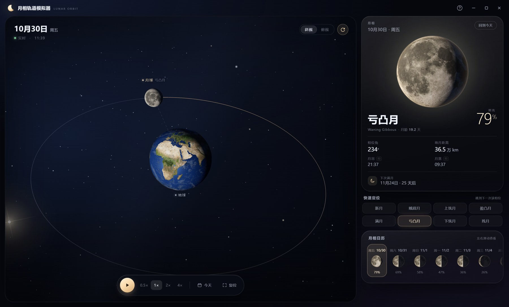

# 月相轨道模拟器

一个以「月球轨道」为核心的月相演示程序，中文界面，支持 Windows 免安装运行。



## 功能

- **地月轨道三维场景**：地球、月球、轨道环、行进轨迹、星空与边缘太阳高光，可拖动旋转、滚轮缩放。
- **真实月相**：根据当前日期计算月相角、照亮比例、月龄与地月距离；大月亮按真实光照呈现盈亏。
- **可持续延伸的月相日历**：左右滑动即可不断向未来（或过去）延伸，点击任意日期跳转。
- **相位快速定位**：新月、娥眉月、上弦月、盈凸月、满月、亏凸月、下弦月、残月，一键跳到下一次。
- **演示动画**：播放/暂停、0.5×–4× 速度、拖动月亮连续浏览一个朔望月。

## 操作

| 操作 | 效果 |
| --- | --- |
| 拖动画面 | 旋转地月系统 |
| 滚轮 | 拉近 / 拉远 |
| 双击画面 / 复位 | 恢复默认视角 |
| 空格 | 播放 / 暂停 |
| ← → | 前后移动一天 |
| 拖动大月亮 | 连续浏览一个朔望月 |
| 滚动月相日历 | 无限延伸日历 |
| R | 复位视角 |
| H / ? | 打开帮助 |

## 下载与运行

- **Windows 免安装版**：在仓库的 **Releases** 页面下载 `LunarOrbit.zip`，解压后双击 `月相轨道模拟器.exe`。
- **从源码运行**：

```powershell
python -m pip install -r requirements.txt
python app.py
```

- 需要 Windows 10/11 与 Microsoft Edge WebView2 Runtime（Windows 11 默认已安装）。
- 完全离线运行，不联网、不写入注册表。

## 说明

- 月相与距离使用 Meeus《Astronomical Algorithms》的简化公式计算，误差约 0.1° / 100 km。
- 月出、月落为按相位估算的地方时，标注为「约」，实际时间因纬度和季节而异。
- 轨道场景中天体大小与距离经过可视化缩放，不是真实比例。
- 月球与地球纹理来自 [Solar System Scope](https://www.solarsystemscope.com/textures/)，遵循 CC BY 4.0；详见 [THIRD_PARTY_NOTICES.md](THIRD_PARTY_NOTICES.md)。

## 开发

```powershell
python -m pip install -r requirements.txt -r requirements-dev.txt
python app.py
```

打包：

```powershell
powershell -ExecutionPolicy Bypass -File build.ps1
```

构建产物位于 `dist/LunarOrbitSim/`。

## 第三方资源与许可

Three.js（MIT）、Solar System Scope 纹理（CC BY 4.0）、pywebview（BSD-3-Clause）等第三方组件的署名与许可信息见 [THIRD_PARTY_NOTICES.md](THIRD_PARTY_NOTICES.md)。
